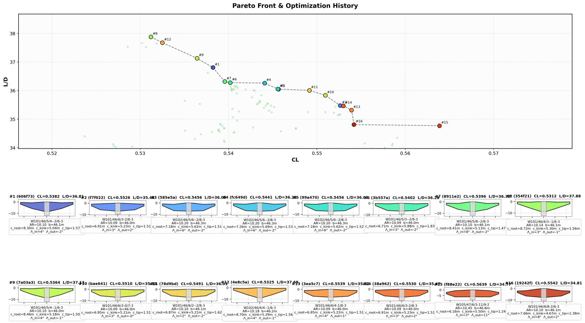

# RAPID (Rapid Aircraft Planform Iterative Design Tool)
**Developed by Ahmet Emre Arslan - Released under MIT License**

> **Quickstart (Windows)**
> 1. `git clone https://github.com/arslanae44/RAPID.git && cd RAPID`
> 2. `SETUP.bat` (one time: Python 3.13 venv + OpenVSP 3.47 + XFOIL + airfoil database)
> 3. `RUN_OPTIMIZATION.bat` (or `RUN_BWB.bat` for a tailless study), then `RUN_PLOTTER.bat`

An NSGA-II and NASA OpenVSP-based optimization tool for aircraft wing planform geometry synthesis, with an integrated **XFOIL airfoil co-optimization** stage and support for both conventional and **blended-wing-body (tailless)** configurations. It couples an NSGA-II genetic optimizer with the OpenVSP 3.47.0 / VSPAERO vortex-lattice (VLM) solver and the XFOIL 6.99 viscous solver. The heavy binaries (Python runtime, OpenVSP, XFOIL) are installed locally in a short one-time setup — see **[SETUP.md](SETUP.md)**. 

*The default wing constraints and reference parameters are loosely based on the C-130 Hercules, but can be fully customized inside the source code.*

---

## 📂 Repository Structure

* **`RUN_OPTIMIZATION.bat`**: Main executable to launch the parallel optimization engine.
* **`CONFIGURE.bat`**: Interactive editor for constraints, design-variable bounds, and flight conditions (shows each value's default *and* your last-entered value).
* **`RUN_BWB.bat`**: Launches the optimizer in **BWB / tailless mode** using the ready `system_files/bwb_config.json` preset (static-margin stability + reflexed airfoils).
* **`RUN_PLOTTER.bat`**: Launches the standard visualization dashboard (Pareto front & wing geometries).
* **`RUN_PERFORMANCE_PLOTTER.bat`**: Launches the advanced interactive performance mapping dashboard (Range vs. Endurance).
* **`RUN_AIRFOIL.bat`**: Standalone airfoil optimization for any saved OpenVSP wing (`system_files/airfoil_config.json` points to the `.vsp3`).
* **`wing_models/`**: Holds generated wing models, aerodynamic solver logs, and the checkpoint file for pausing/resuming.
* **`PLOTS/`**: Stores the high-resolution graphical outputs generated by the plotters.
* **`RESET.bat`**: Safeguarded script to wipe previous results and reset the optimization study.
* **`system_files/planform_opti.py`**: NSGA-II driver (CLI + interactive menus).
* **`system_files/vsp_worker.py`**: Per-wing OpenVSP/VSPAERO evaluation, run in its own process.
* **`system_files/geometry.py`**: Planform geometry (chords, N spanwise stations, MAC) shared by every module.
* **`system_files/airfoil_opti.py`**: Airfoil co-optimization (Phase 2), callable from the optimizer or standalone.
* **`system_files/xfoil_handler.py`**: Headless XFOIL 6.99 driver used by the airfoil co-optimization stage.
* **`system_files/xfoil/`**: Embedded portable XFOIL solver binaries.
* **`airfoil_database/`**: Local airfoil coordinate catalogs, grouped by Reynolds regime (`Low_Re`, `Medium_Re`, `High_Re`) plus the optional full `UIUC_All` set.
* **`system_files/download_airfoils.py` / `download_xfoil.py`**: One-shot helpers to (re)fetch the full UIUC airfoil database and the XFOIL binary.
* **`system_files/rapid_config.py`**: Central configuration schema + loader (single source of truth for all tunable defaults).
* **`system_files/rapid_config.json`**: Active configuration written by `CONFIGURE.bat` and read by `RUN_OPTIMIZATION.bat`.
* **`system_files/bwb_config.json`**: Ready-made BWB/tailless preset used by `RUN_BWB.bat`.
* **`airfoil_database/Reflexed/`**: Curated reflexed / tailless airfoil catalog (MH, Eppler, EH, S-series) used by BWB co-optimization.

---

## ⚙️ First-Time Setup
Run **`SETUP.bat`** once. It needs **Python 3.13 or 3.11 (64-bit)** because the OpenVSP 3.47.0 Python module is only built for those versions (it offers to install Python 3.13 with `winget` if neither is found), then creates `.venv`, installs the requirements, and downloads OpenVSP, XFOIL and the UIUC airfoils. Manual steps and troubleshooting are in **[SETUP.md](SETUP.md)**.

The curated airfoil catalogs (`Low_Re` / `Medium_Re` / `High_Re` / `Reflexed`) ship with the repo. `SETUP.bat` also fetches the full ~1650-airfoil UIUC set (`download_airfoils.py`), which is recommended — the airfoil co-optimization can sweep the whole database for the best section per station.

---

## 📖 Usage Instructions

1. Run **`RUN_OPTIMIZATION.bat`**.
2. Enter the number of CPU cores to allocate (Default: all logical CPUs). The engine runs fully in parallel utilizing a dynamic worker pool.
3. Enter the **Wake Iteration** count (Default: `mesh.WAKE_ITERS` = 3).
4. The system will automatically detect existing checkpoints. If a checkpoint is found, it asks for the number of continuation generations. If not, it initializes a fresh run by asking for population size and generation count.
5. You can stop the process at any point using **`Ctrl + C`**. The current generation's analysis will cleanly finish and save the state, allowing you to resume exactly where you left off later.

* **Performance benchmark:** One wing takes ~3 s of VSPAERO time at the default 33x24 mesh. On a 16-thread laptop, 12 workers evaluate a 12-wing generation in ~15-20 s.
* **Headless / batch mode:** every prompt has a flag, e.g.
  `python system_files\planform_opti.py --yes --pop 16 --gens 10 --cores 8 --fresh --airfoil`
  (`--yes` = no prompts, `--fresh` = ignore the checkpoint, `--airfoil` = run Phase 2 on the best-L/D wing afterwards, `--seed`, `--wing`). `RAPID_OUTPUT_DIR` redirects `wing_models/` and `RAPID_CONFIG_FILE` selects a config.
* **Recommendation:** It is highly recommended to run for at least 100 generations to allow the Pareto Front to mature.
* **Physics Note:** `0 wake iterations` solves with a **fixed wake**. This means downwash interactions are neglected but the solver becomes highly stable and extremely fast. If a tailplane is introduced in future steps, wake iterations should be increased.

### 🔄 Resetting the Run
To completely wipe the `wing_models/` directory and reset the optimization history, run **`RESET.bat`**. As a safety measure, it will prompt you for confirmation (`y`) three times before proceeding.
* *Note: The current architecture is highly lightweight, so resetting will not yield massive disk space recovery, but serves as a clean slate.*

---

## ✈️ Airfoil Co-Optimization *(Experimental)*
After the planform Pareto front matures, the optimizer can chain into an **airfoil co-optimization stage** that tailors the sectional profiles to the winning wing:

1. **Sectional extraction:** Local chord, Reynolds number, and effective angle of attack are extracted at N spanwise stations of the selected wing (root, kink, tip + optional extra stations).
2. **Parallel XFOIL sweep:** Candidate airfoils from the chosen catalog are run in parallel through the embedded XFOIL solver. Sections below the `airfoil.MIN_TC_*` thickness screen are skipped; if that leaves no feasible profile, the screen is relaxed automatically. Unconverged or unphysical XFOIL results are skipped (your database is never modified).
3. **Geometric refinement (optional):** The winning profiles can be auto-refined via XFOIL `TFAC` thickness/camber scaling to squeeze out additional L/D.
4. **Back-feed:** The best profile per station is written to `system_files/active_airfoils.json` (`{"stations": [{"eta", "airfoil"}]}`, eta = spanwise fraction) and copied into `system_files/active_airfoils/`. Every later OpenVSP wing gets, at each of its stations, the profile of the nearest back-fed station.

`active_airfoils.json` is created by this stage (it is not tracked in git). Without it every station uses the baseline `naca2412`; in BWB mode, the `BASELINE_AIRFOIL` reflexed section.

**Standalone:** `RUN_AIRFOIL.bat` runs the same pipeline on any saved `.vsp3` wing, with no planform optimization. Set `vsp3`, `n_sections`, `catalog` and `refine` in `system_files/airfoil_config.json`; an example preset ships in `system_files/presets/`.

---

## 🏷️ Wing Naming Convention
Optimal solutions are dynamically named based on their geometric parameters:
`W(AR)/(Span)/(Kink_Frac)/(Sweep_Inner)-(Sweep_Outer)/(Taper_Inner)-(Taper_Outer)`

* **Example:** `W91/39/5/7-5/6-8` represents:
  * **Aspect Ratio (AR):** 9.1
  * **Span:** 39 m
  * **Kink Fraction:** 0.5
  * **Sweep (Inner / Outer):** 7° / 5°
  * **Taper (Inner / Outer):** 0.6 / 0.8 (Decimals scaled by 10)

---

## 🛠️ Configuring Constraints & Parameters
Run **`CONFIGURE.bat`** to edit the study without touching source code. It walks through every tunable parameter and, for each one, shows both the built-in **default** and the value you entered **last** time — press Enter to keep the current value or type a new one.

Editable groups:

* **Constraints:** minimum L/D, max |Cm| (conventional mode), minimum CL.
* **Design bounds:** lower/upper limits for aspect ratio, kink fraction, inner/outer taper, and inner/outer sweep.
* **Flight conditions:** true airspeed, air density, temperature, viscosity, reference area, angle of attack, root incidence.
* **BWB settings:** static-margin window, trim tolerance, airfoil catalog, CG location.
* **Geometry:** fuselage half-width, span cap, admissible root-chord range, number of spanwise airfoil stations (`N_SECTIONS`).
* **Mesh:** chordwise / spanwise tessellation (`TESS_W` / `TESS_U`), wake iterations, per-wing timeout.
* **Airfoil co-opt:** thickness screen per zone, section Cm floor, XFOIL Mach, alpha spread.

Values are saved to `system_files/rapid_config.json` and applied automatically on the next `RUN_OPTIMIZATION.bat`. If the file is absent, the built-in defaults are used, so the tool always runs.

---

## 🦅 BWB / Tailless Optimization
Run **`RUN_BWB.bat`** to optimize a blended-wing-body / tailless configuration. It points the engine at the `system_files/bwb_config.json` preset (higher sweep, lower taper, `BWB_MODE` on) and changes the physics in three ways:

1. **Longitudinal stability.** Because there is no tail, each candidate is solved at **two angles of attack** in the same VSPAERO run. The moment slope about the quarter-MAC point (the MAC leading edge accounts for sweep) gives the **neutral point** `x_np = x_ref − MAC·dCm/dCL`. If `CG_X` is set, `SM = (x_np − CG_X)/MAC` must lie in `SM_MIN … SM_MAX`. If `CG_X` is blank, the CG is placed at the target margin (middle of the window), so the binding question becomes the trim check below: can the wing trim at a CG that gives the static margin you want?
2. **Trim as a hard constraint.** The pitching moment transferred to that CG at the design point must satisfy `|Cm_trim| ≤ CM_TRIM_TOL`, so the wing trims without elevons. (In BWB mode the conventional `CM_MAX` cap is not used.)
3. **Reflexed airfoils.** The co-optimization sweep draws from the `airfoil_database/Reflexed/` catalog and the winner selection rewards near-zero / slightly-positive `Cm` (reflexed sections) rather than pure L/D, so the chosen profiles reinforce trim instead of fighting it.

Stability and aerodynamics are evaluated **simultaneously** (one VSPAERO run yields CL, L/D, Cm and the moment slope together), so the static-margin and trim requirements drive the planform search directly rather than being checked after the fact. Tune the window and bounds in `system_files/bwb_config.json` (or copy values in with `CONFIGURE.bat`).

> **Note:** The model is wing-only (no centerbody geometry) and there is no mass model; the two-point linear `dCm/dCL` is a low-to-medium fidelity estimate. Validate promising tailless designs with higher-fidelity tools.

---

## 📊 Visualizations & Plotting

* Run **`RUN_PLOTTER.bat`** or **`RUN_PERFORMANCE_PLOTTER.bat`** to visualize Pareto sets and planform designs.
* Graphics are saved sequentially as `PLOTS/performance_plot_X.png` without overwriting existing files.
* **Color Legend:**
  * 🟢 **Green points:** Feasible designs that fully satisfy constraints.
  * 🔴 **Red points:** Violating designs (excluded from Pareto considerations).
* **Interactive Popups:** When launched, a high-performance UI pops up. Moving your mouse over the wing subplots instantly highlights their respective Pareto coordinate (scaling up to 4x and glowing golden), and vice versa.
* **Performance Map:** In addition to the standard $C_L$ vs. $L/D$ charts, the tool features a specialized propeller aircraft performance map plotting **Range Efficiency ($L/D$)** against **Endurance Efficiency ($C_L^{1.5}/C_D$)**.

---

## ⚖️ Objectives and Constraints
* **Objectives:** Maximize $L/D$ (Aerodynamic Efficiency) and $C_L$ (Lift Coefficient).
* **Constraints** (defaults, all editable via `CONFIGURE.bat`):
  * $L/D \geq 15.0$
  * $|C_M| \leq 0.35$ about the quarter-MAC point (conventional mode)
  * $C_L \geq 0.15$
  * BWB mode: static-margin window and $|C_{M,trim}| \leq$ `CM_TRIM_TOL` instead of the $C_M$ cap
* Upper bounds for $C_L$ and $L/D$ are also actively imposed to filter out non-physical diverging solver results.

---

## 📈 Live Process Monitoring
* **`n_gen`**: Current generation count.
* **`n_eval`**: Total number of unique wing designs evaluated.
* **`n_nds`**: "Non-dominated Solutions" count (number of elite candidates sitting on the active Pareto Front).
* **`cv_min` / `cv_avg`**: Constraint Violation metrics. Convergence toward `0` indicates feasible populations.
* **`eps`** (Epsilon): Measures progression rate between consecutive generations.
* **`hv_area`**: Hypervolume of the feasible front above the (CL_MIN, LD_MIN) corner, a convergence-quality indicator.

---

##   Future Roadmap

### 1. Coupled Wing-Tail Design
Simultaneously designing the wing and the tailplane. This will enable integrated, co-optimized planform sizing alongside trim and longitudinal static margin assessments.

### 2. Iterative Airfoil-Planform Co-Optimization ✅ *Implemented (experimental)*
XFOIL is now integrated directly into the workflow (see **Airfoil Co-Optimization** above): local sectional properties are extracted from the converged planform, candidate airfoils are screened in parallel through XFOIL, and the winners are back-fed into OpenVSP. Remaining work is to tighten the loop into a fully automated, multi-pass planform↔airfoil convergence cycle.

### 3. Discrete Airfoil Databases & Scraping ✅ *Implemented (experimental)*
The full UIUC airfoil database is fetched via `download_airfoils.py` and curated into Reynolds-regime catalogs. XFOIL batch evaluations build local polar lookups, candidate pools are screened per station, and root/kink/tip profiles are assigned independently. Future work: expose "Airfoil Type" as a first-class discrete design variable inside the NSGA-II search itself.

---

> ⚠️ **Disclaimer / Note:**
> A high-fidelity CFD validation study is highly recommended to correlate and validate the low-to-medium fidelity vortex-lattice predictions.
